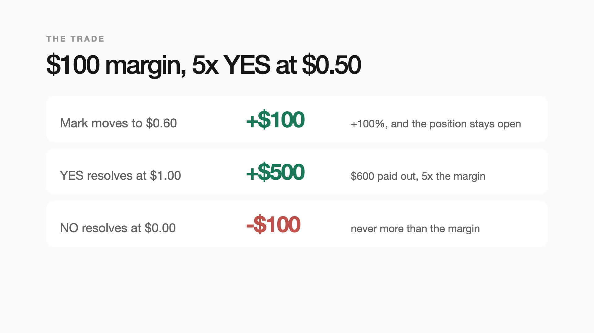

# Basis-AMM

Leveraged positions on prediction markets, settled on NEAR. A trader posts margin `M`, picks
leverage `L` and an outcome, and gets a nonrecourse synthetic claim against a counterparty vault:

- the most they can lose is `M`;
- profit is not capped at `M`. A 5x YES at $0.50 with $100 margin pays $600 if YES wins;
- nothing closes a winning position for them. Only their own close or trigger, a valid
  liquidation of a losing position, or event settlement ends it.

The vault (LP token `bLP`) is the counterparty to every fill. There is no order book and no
matching between traders. Before a position opens, the contract reserves the worst-case payout
for every outcome of that event and checks it against per-event and global stress budgets.

This implements `docs/spec/Basis_AMM_Engineering_Spec_v0.1.md`. **Testnet and test funds only.**
Live Polymarket markets are supported end to end: real order books for marks, real resolution
from Polymarket's API and the chain, and hedges that fill against the live book (paper by default;
real orders only with explicit opt-in, see `docs/hedging.md`). Section 14
decisions, including the calibrated risk premium and leverage caps, are in `docs/decisions.md`.

## Demo video

[`video/basis-amm-demo.mp4`](video/basis-amm-demo.mp4) (86 s, 1080p). Built with Remotion from
footage the Playwright capture script recorded on the real app (`video/src`, `video/footage`).
Render it yourself with `pnpm --filter @basis/video render`.

[](video/basis-amm-demo.mp4)

## What is in the repo

| Path | What it is |
|---|---|
| `crates/oracle-tee` | The mark oracle that runs inside OutLayer's Intel TDX workers (`wasm32-wasip2`): TEE-generated key, second-source check. See `docs/tee-oracle.md`. |
| `crates/executor-tee` | Hedge executor signer for OutLayer TDX workers: signs only bounded Polymarket orders. See `docs/hedging.md`. |
| `crates/basis-math` | Fixed-point payoff, depth walk, scenario reserve, fees, fair-value gate, bLP share math. Property-tested. |
| `contracts/basis-core` | The NEAR contract: market registry with versioned policies and a timelock, the vault and `bLP` (NEP-141), margin engine, oracle verifier, hedge receipts, insurance ledger, views. |
| `contracts/mock-usdc` | `tUSDC`, a 6-decimal testnet NEP-141 with a faucet. Not money. |
| `packages/sdk` | TypeScript client, Borsh report encoder, ed25519 reporter signing, manifest converter, math mirror checked against Rust test vectors. |
| `packages/stack` | Sandbox runner, full-stack deployer (sandbox or testnet), mock venue. |
| `services/basis-node` | Oracle worker, keeper, mock hedge executor, reconciler, SQLite indexer, quote engine, REST + WebSocket API, read-only Polymarket discovery. |
| `apps/web` | The dashboard: 10 pages ported from the approved mockup, dev-key and wallet-selector signing. |
| `policies/examples` | Market manifests: crypto, sports, election, Fed (3 outcomes), commodity, plus post-deploy weather. |
| `tests/e2e` | Spec section 11 acceptance suite (items 1-12 plus adversarial) on a real nearcore node. |
| `research` | Strategy simulator: POOL_ONLY vs exact hedge vs margin escrow vs proxy hedge, with a fee sweep. |
| `video` | Remotion demo video and the captured footage. |
| `docs` | Architecture, decisions, deviations, threat model, risk policy, deployment, API, testnet proofs. |

## Run it locally

Requirements: Node 22+, pnpm 10, Rust (the repo pins 1.95 via `rust-toolchain.toml`),
`cargo-near` 0.23, and the nearcore sandbox binary.

```bash
pnpm install
infra/local-dev/install-sandbox.sh          # nearcore 2.14.0 sandbox (builds liblzma on macOS if missing)
scripts/build-contracts.sh                  # out/basis_core.wasm, out/mock_usdc.wasm
cd services/basis-node && npx tsx src/main.ts --sandbox   # sandbox :3030, deploys once, API :8797
pnpm --filter @basis/web dev                # dashboard, pick a dev account in Settings
```

`--sandbox` deploys the whole stack on first run (7 markets, $100,000 vault, $5,000 insurance,
funded test users) and resumes it on later runs.

## Tests

```bash
cargo test -p basis-math                          # 37 unit + property tests, writes TS vectors
pnpm --filter @basis/sdk test                     # TS math matches Rust bit for bit
pnpm --filter @basis/e2e test                     # 16 acceptance tests on a fresh sandbox (~10 min)
pnpm --filter @basis/node test                    # 7 automation tests: keeper, executor, indexer
pnpm --filter @basis/web test                     # 25 unit tests
pnpm --filter @basis/web e2e                      # 7 Playwright tests against the running stack
pnpm --filter @basis/research test                # simulator invariants
cargo test -p oracle-tee -p executor-tee          # TEE oracle and executor signer (EIP-712 reference vector)
pnpm --filter @basis/e2e test                     # also runs tee.test.ts and lifecycle.test.ts
BASIS_LIVE_TESTS=1 pnpm --filter @basis/node test # live Polymarket: books, resolution, SDK signing via TEE, paper-hedged trade
scripts/build-oracle-tee.sh                       # wasm32-wasip2 build + SHA-256 to pin
BASIS_TARGET=testnet BASIS_TESTNET_MASTER=<funded>.testnet pnpm --filter @basis/e2e test
```

The acceptance suite maps one test to each spec item: the $100 5x example ($500 reserve, +$100
still open, +$500 / $600 on YES, -$100 on NO), opposing YES/NO fills, the exact-share hedge
contrast ($400 adverse loss), HEDGE_REQUIRED with partial and all-or-none fills, admitting a new
market and a CLOSE_ONLY policy without redeploying, oracle forgery/staleness/replay, disputes,
the $0.80 fair-price rejection (trader EV exactly +$80), shallow and wide books, and asset
conservation after every step.

## NEAR testnet

- The full acceptance suite passed on NEAR testnet, 16 of 16. Every step's transaction is linked
  in [`docs/integration-proofs/README.md`](docs/integration-proofs/README.md).
- A live demo stack runs at
  [`core.live.basislive211107.testnet`](https://testnet.nearblocks.io/address/core.live.basislive211107.testnet)
  (accounts in `docs/integration-proofs/testnet-live.json`). Point basis-node at a deployment
  file and the dashboard at basis-node to trade on it with MyNearWallet or Meteor.
- The latest stack (`core.basisv349012.testnet`) traded a live Polymarket market on testnet: a user
  order hedged at the live ask, closed, unwound, and a really-resolved market settled from the
  Polymarket API and the Conditional Tokens contract. Transactions are in the same proofs file.
- `docs/deployment.md` explains how to deploy your own stack from faucet accounts.

## License

MIT
